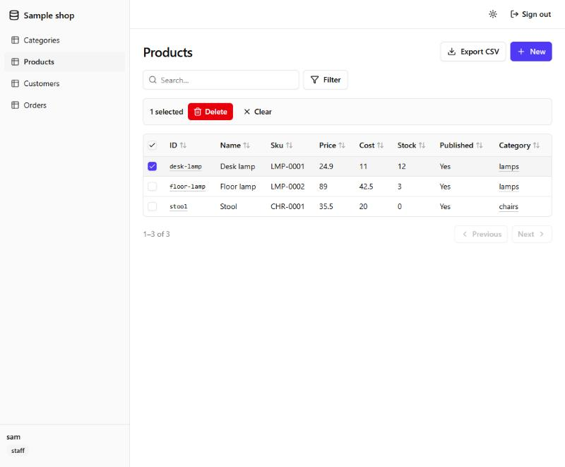

# BaseKt

**A modular backend and admin toolkit for Ktor.** You install only the pieces you need, as Ktor plugins: a
schema-driven API, auth, data adapters, files, audit and an admin panel. It's built for a shop, a SaaS, a game's back
office or anything else that needs a backend and an admin, without handing your app to a platform.

**📖 Documentation: [basekt.github.io/basekt](https://basekt.github.io/basekt/)**

> **Status: 0.1.0 is on Maven Central.** It has the schema, the data SPI with its in-memory and Exposed adapters and
> contract tests, the `install(BaseKt)` REST plugin with hooks, Ktor auth adapters, the JSON admin API, and the sample
> shop. The admin panel, `basekt-admin-ui`, works on `main` and ships in 0.2.0.

## What it looks like

```kotlin
fun Application.module() {
    install(Authentication) {
        baseKtJwt("jwt", JwtSettings.from(environment.config.config("auth.jwt")))   // basekt-auth
    }
    install(BaseKt) {
        dataSource = ExposedDataSource(database, schema)  // or InMemoryDataSource(), or any other adapter
        identities = AuthIdentities("jwt")                 // roles from the JWT, checked by the permissions
        resources {
            resource("products") {
                string("name") { required(); length(max = 120) }
                decimal("price") { required(); min("0.01") }
                belongsTo("category", "categories")
                permissions { read(everyone); write("staff") }
            }
            resource("categories") {
                string("name") { required() }
                hasMany("products", "products", foreignField = "categoryId")
                permissions { read(everyone); write("staff") }
            }
        }
        hooks {
            beforeUpdate("products") { update ->
                if (update.changes["price"] == null) proceed(update.changes) else veto("price", "Prices are frozen.")
            }
        }
    }
    install(BaseKtAdmin) { path = "/admin/api" }           // basekt-admin-api
    install(BaseKtAdminUi) { path = "/admin" }             // basekt-admin-ui: the panel, from the jar
}
```

That serves a REST API for each resource, a JSON admin API, and an admin panel rendered from the schema. The
[docs](https://basekt.github.io/basekt/) cover the schema, permissions and record scopes, hooks, automatic fields,
concurrent writes, actions and workflows, aggregates and reports, audit, files, the admin API and panel, and the
adapters.



## Installing

Every module is on Maven Central as `io.github.basekt:<module>:<version>`:

```kotlin
dependencies {
    implementation("io.github.basekt:basekt-server:0.1.0")
    implementation("io.github.basekt:basekt-data-exposed:0.1.0")   // or basekt-data-memory
    implementation("io.github.basekt:basekt-auth:0.1.0")
    implementation("io.github.basekt:basekt-admin-api:0.1.0")
    implementation("io.github.basekt:basekt-admin-ui:0.2.0")      // from 0.2.0
    testImplementation("io.github.basekt:basekt-testing:0.1.0")
}
```

The latest `main` is published as `0.2.0-SNAPSHOT` to Maven Central's snapshots repository
(`https://central.sonatype.com/repository/maven-snapshots/`). Releases are cut by pushing a version tag; see
[RELEASING.md](RELEASING.md).

## Modules

| Module | Status | What it is |
|---|---|---|
| `core:basekt-schema` | ✓ works | resources, fields, relations, validation and permissions as data (multiplatform, no Ktor) |
| `server:basekt-server` | ✓ works | `install(BaseKt)`: the schema-driven REST API, permissions, hooks and lifecycle |
| `server:basekt-data` | ✓ works | the `DataSource` SPI: queries, writes, transactions, and optional capabilities such as `Counting` |
| `server:basekt-data-memory` | ✓ works | in-memory adapter, for tests, samples and prototypes |
| `server:basekt-data-exposed` | ✓ works | Exposed/JDBC adapter: Postgres, MySQL, H2. Keyset cursors, one-query `getMany`, savepoints |
| `server:basekt-auth` | ✓ works | Ktor Authentication adapters (JWT, bearer), `PrincipalRoles` mapped to permissions, typed 401 and 403 |
| `admin:basekt-admin-api` | ✓ works | `install(BaseKtAdmin)`: a JSON admin API from the schema (per-caller schema, list and search, CRUD, bulk delete, CSV export) and its TypeScript types |
| `testing:basekt-testing` | ✓ works | the `DataSourceContract` and `BlobStoreContract` suites every adapter runs, plus test fixtures |
| `admin:basekt-admin-ui` | ✓ works | `install(BaseKtAdminUi)`: a schema-driven admin panel (React, shadcn/ui and Tailwind, prebuilt into the jar) with a typed Kotlin theme |
| `samples:sample-shop` | ✓ works | a small shop backend: Exposed on H2, JWT and bearer auth, a pricing hook, the admin API and the admin panel |
| `server:basekt-graphql` | later | a GraphQL API generated at runtime from the same schema, on the same `DataSource` and service layer |
| `server:basekt-realtime` | later | change feeds over WebSockets |
| `server:basekt-storage` | ✓ works | the `BlobStore` SPI: streamed puts and reads of files, byte ranges, and optional listing and presigned URLs |
| `server:basekt-storage-memory`, `-local` | ✓ works | in-memory and local-filesystem stores, both passing the `BlobStoreContract` suite |
| `server:basekt-files` | ✓ works | `install(BaseKtFiles)`: buckets with limits and permissions, streamed uploads, downloads with ranges and safe headers, and `file` fields kept in step with their files |
| `server:basekt-audit` | ✓ works | `install(BaseKtAudit)`: a log of every create, update, delete and action, with who, when and what changed, in the write's own transaction |
| `server:basekt-storage-s3` | ✓ works | an S3 store for AWS, MinIO, R2 and other S3-compatible services: Signature V4 with no SDK, multipart uploads, ranges and presigned URLs |
| `commerce:basekt-commerce`, `commerce:basekt-storefront` | ✓ works | an optional group for selling online. `basekt-storefront` is `install(BaseKtStorefront)`: listing and detail pages and a public JSON API generated from `storefront { }` blocks in the schema, with an availability hook for stock, CSS and page-renderer hooks for the layout, and a per-client rate limit. `basekt-commerce` is an umbrella that pulls in the commerce modules. Payments, holds, idempotency and customers are planned, each as its own module |
| `client:basekt-client` | later | a typed multiplatform client SDK: auth, queries, realtime, storage |
| `server:basekt-data-jdbc`, `-mongo` | later | more data adapters |
| `server:basekt-auth-oidc`, `-firebase` | later | more auth providers |

## Building and contributing

`./gradlew build` with JDK 17 or later, and Node 22 or later for the admin panel's web build. The
[building guide](https://basekt.github.io/basekt/building/) covers the optional S3 and Postgres test runs, the panel's
dev server and the TypeScript types. Read [AGENTS.md](AGENTS.md) for the design rules every module follows, and copy
its checklist into each PR.

## License

[Apache-2.0](LICENSE).
